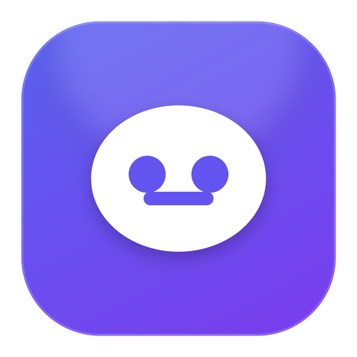

# ⚡ AntiCord (v1.0.0 — Beta Pública)

**Comunicación en tiempo real sin muros de pago (sin paywalls estilo Nitro).**  
Diseñado para comunidades, gamers, equipos y servidores privados o públicos.

[📥 Descargar](https://github.com/A-Graterol/AntiCord/releases) • [🐛 Reportar Bug](https://github.com/A-Graterol/AntiCord/issues) • [☕ Apoyar el Proyecto](#-apoya-el-proyecto) • [📜 Términos](./TERMS.md)

---

## ✨ ¿Por qué AntiCord?

AntiCord nace para ofrecer todas las funciones avanzadas de comunicación y personalización **desbloqueadas para todos los usuarios**, con soporte multiplataforma y arquitectura optimizada.

### 💬 Chat y Comunidades en Tiempo Real
- **Servidores públicos y privados** por invitación (con enlaces personalizables, caducidad y límite de usos).
- **Canales variados:** Texto, anuncios, foro, voz y escenario, con soporte para **canales privados por miembro**.
- **Mensajería completa:** Mensajes directos (MDs), grupos, hilos (*threads*), encuestas en vivo, formato Markdown, notas de voz, búsqueda avanzada (`Ctrl+F`) y mensajes guardados.
- **Privacidad real:** Sistema de solicitudes de amistad (nadie puede verte ni escribirte si no son amigos o comparten un servidor).
- **Archivos sin límites absurdos:** Adjuntos de hasta **50 MB**.

### 🎙️ Voz, Vídeo y Entretenimiento
- **WebRTC P2P con respaldo Relay automático** (compatible incluso con redes **CGNAT**).
- **Audio profesional:** Supresión de ruido (WebRTC / RNNoise) y filtros de voz estilo OBS (puerta de ruido, EQ, compresor y limitador).
- **Diversión en sala:** Modulador de voz con **24 efectos en vivo**, Soundboard con editor/recortador de audio, Bot de Música (**AntiMusic**) y **Watch Together** (YouTube sincronizado).
- **Streaming:** Compartir pantalla/ventana hasta **4K / 60fps**, grabación de clips (30s) y ventana flotante PiP.
- **App de Escritorio Windows:** Atajos globales y **Modo Seguro Anti-Cheat**.

### 🎨 Personalización Total Desbloqueada
- **16 temas exclusivos** y fondos personales.
- Marcos animados SVG en avatares, **9 fuentes especiales**, placas animadas y efectos de tarjeta de perfil.

---

## 🛠️ Stack Tecnológico

---

## 📥 Descargas y Acceso

> ⚠️ **Estado Beta Pública:** El servidor oficial se encuentra actualmente en fase experimental para pruebas de carga y feedback de la comunidad.

| Plataforma | Formato | Descarga / Acceso |
| :--- | :--- | :--- |
| **Windows (Escritorio)** | Instalador `.exe` | [Descargar última versión](https://github.com/A-Graterol/AntiCord/releases) |
| **Android** | Paquete `.apk` | [Descargar última versión](https://github.com/A-Graterol/AntiCord/releases) (o desde la barra superior en Web) |
| **Web / PWA** | Navegador moderno | [https://anticord.andreslab.dpdns.org](https://anticord.andreslab.dpdns.org) |

---

## 🐛 Feedback y Reporte de Errores

¿Encontraste un fallo o tienes una sugerencia?  
Abre un ticket en la pestaña [**Issues**](https://github.com/A-Graterol/AntiCord/issues) indicando tu plataforma (Web, Windows o Android) y los pasos para reproducirlo.

---

## ☕ Apoya el Proyecto

AntiCord es creado y mantenido de forma independiente por **Andrés Graterol**, sin muros de pago ni suscripciones obligatorias.  
Si disfrutas la plataforma y quieres ayudarnos a mantener los servidores 24/7, mejorar la calidad de voz/streaming y seguir sumando nuevas funciones gratuitas para toda la comunidad, cualquier aporte voluntario hace una gran diferencia:

| Método | Detalles | Escanea o accede |
| :--- | :--- | :---: |
|  | **Pay ID:** `213725450` · **Alias:** `Aklo07` Acepta **USD / USDT / EUR** y múltiples divisas desde cualquier país (0% comisión). |  |
|  | **Enlace directo:** [Aportar con Zinli](https://recargas.zinli.com/bCwdgXwBAR7damgnhE33xk) **Correo Zinli:** `andresaga47@gmail.com` · Aportes en **USD** desde Zinli o tarjeta internacional. |  |

- 📩 **Contacto comercial / Licencias privadas / Soporte:** `anticord.ca@gmail.com`

---

## 📜 Información Legal

Al descargar o utilizar AntiCord aceptas nuestros documentos legales:
- [Licencia de Uso (`LICENSE`)](./LICENSE)
- [Términos de Servicio (`TERMS.md`)](./TERMS.md)
- [Política de Privacidad (`PRIVACY.md`)](./PRIVACY.md)
- [Seguridad y Reporte de Abuso / DMCA (`SECURITY.md`)](./SECURITY.md)

---

  © 2026 <strong>Andrés Graterol</strong> — Todos los derechos reservados.

